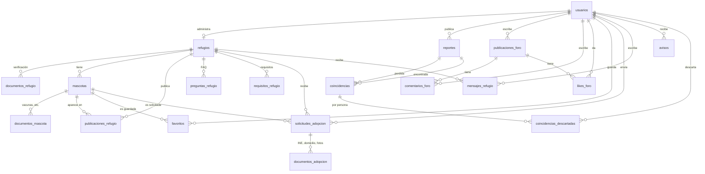

# Base de datos de HuellApp (HU-27)

Oracle Autonomous Database en Oracle Cloud (OCI), esquema `HUELLAPP_DEV`. La define
[`api/database/esquema.sql`](../api/database/esquema.sql) y la mantiene al día `php artisan migrate`
(crea tablas y **columnas nuevas** sin borrar nada; ver `COLUMNAS_NUEVAS` en `api/src/Migraciones.php`).
La API se conecta con el wallet de Oracle (`TNS_ADMIN`) y el servicio `huellapp_tp`.

## Diagrama

Solo se muestran las relaciones (llaves foráneas). Todas usan `ON DELETE CASCADE`: si se borra una cuenta,
se borra lo suyo.

## Tablas

| Tabla | Qué guarda | Notas |
| --- | --- | --- |
| `usuarios` | Cuentas: usuario, refugio y admin | Contraseña con `password_hash`; secreto de Google Authenticator **cifrado** (`totp_secreto`). |
| `refugios` | Datos del refugio y su estado | `pendiente` → `aprobado` / `rechazado` / `suspendido`; lo revisa el admin. |
| `documentos_refugio` | Documentos de verificación del refugio | Archivos privados en `api/storage/uploads/documentos`. |
| `mascotas` | Inventario de cada refugio | `estatus`: disponible, en proceso, adoptado. |
| `documentos_mascota` | Cartilla de vacunas, esterilización… | Privados; los revisa el admin. |
| `publicaciones_refugio` | Publicaciones de mascotas del refugio | Republicación automática cada N días. |
| `publicaciones_foro` | Muro de la comunidad y alertas de reportes | `reporte_id` liga la alerta a su reporte. **HU-18:** `moderacion` (visible / revision / quitado), `moderacion_motivo`, `moderacion_fuente`. |
| `comentarios_foro` | Comentarios del muro | Misma moderación que las publicaciones. |
| `likes_foro` | «Me gusta» (huella) | Uno por persona y publicación. |
| `reportes` | Mascotas perdidas y encontradas | Foto, zona, punto del mapa, **seña secreta** (nunca se publica) y análisis de la IA. |
| `coincidencias` | Parejas perdida ↔ encontrada con su % | Las calcula la IA en segundo plano. |
| `coincidencias_descartadas` | «No es mi mascota» | Cada persona descarta por su cuenta. |
| `solicitudes_adopcion` | Solicitudes de adopción | **HU-22:** `resumen_ia` (JSON). **HU-23:** `guia_ia` (consejos de cuidado, JSON). |
| `documentos_adopcion` | Identificación, comprobante y fotos del espacio | Solo los ve el refugio que recibe la solicitud. |
| `favoritos` | Mascotas guardadas | Para compararlas. |
| `mensajes_refugio` | Mensajes de usuarios a refugios | Con respuesta del refugio. |
| `preguntas_refugio` | Preguntas frecuentes de cada refugio | Las usa el asistente del formulario de adopción. |
| `requisitos_refugio` | Requisitos de adopción | Obligatorios u opcionales. |
| `avisos` | Campana de avisos | Coincidencias, respuestas, cambios de estado, moderación. |
| `intentos_login` | Contadores con ventana de tiempo | Bloqueo de login y 2FA, y límites de KIRO y de borradores con IA. |

## Archivos (fuera de la base)

Las fotos y documentos se guardan en disco (`api/storage/uploads/imagenes` y `.../documentos`); la base solo
guarda la ruta. En el servidor publicado quedan en `/opt/huellapp/api/storage/uploads`: **respáldenlos** si se
recrea la máquina virtual.
